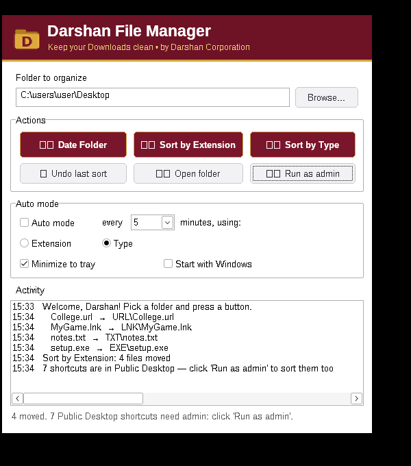
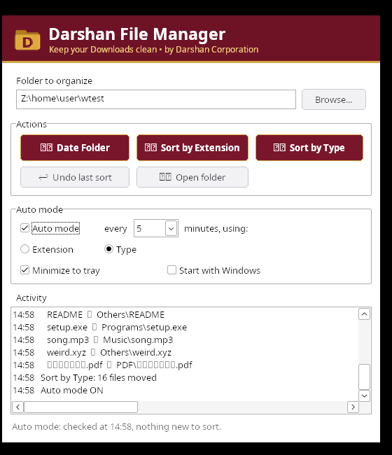

<p align="center">
  
</p>

<h1 align="center">Darshan File Manager</h1>

<p align="center">
  A tiny, fast and portable Windows app that keeps your Downloads, Desktop or any folder clean — sort by type, by extension or into a dated folder with one click, or let Auto mode do it in the background.
</p>

<p align="center">
  
  
  
  
  
</p>

---

## ✨ Features

| | Feature | What it does |
|---|---|---|
| 🗂 | **Sort by Type** | Moves files into smart category folders — `Images`, `Videos`, `Music`, `PDF`, `Documents`, `Ebooks`, `Archives`, `Programs`, `Code`, `Fonts`, `Design`, `Contacts_Calendar`, `Torrents`, `Others`. Knows **400+ file extensions**. |
| 🔤 | **Sort by Extension** | One folder per extension — `JPG`, `PDF`, `MP4`, `ZIP`, … (files with no extension go to `NO_EXTENSION`). Handles double extensions like `.tar.gz`. |
| 📁 | **Date Folder** | Creates a folder with today's date (`DD-MM-YYYY`) in the selected location. |
| ↩ | **Undo last sort** | Puts every moved file back exactly where it was. |
| ⏱ | **Auto mode** | Sorts the folder automatically every 1, 5, 15 or 30 minutes (by Type or by Extension). |
| 🖥 | **Start with Windows** | Optional — launches quietly in the system tray at login. |
| 🔽 | **Minimize to tray** | Keeps running in the background; double-click the tray icon to open. |
| 🛡 | **Run as admin** | Also sorts the *all-users* shortcuts in `C:\Users\Public\Desktop` when you sort your Desktop. |
| 📜 | **Activity log** | Shows exactly which file went where. |

### Safe by design
- Never overwrites — duplicate names become `file (1).jpg`, `file (2).jpg`, …
- Skips files that are still downloading (`.crdownload`, `.part`, `.tmp`, …) and system files (`desktop.ini`, `thumbs.db`).
- Warns before sorting system/root folders (`C:\`, `Windows`, `Program Files`) and Auto mode never touches them.
- Single instance, no installer, no internet, no telemetry.

---

## 📸 Screenshots

<p align="center">
  
</p>
<p align="center">
  
</p>

---

## ⬇️ Download & Run

1. Download **[`DarshanFileManager.exe`](release/DarshanFileManager.exe)** (≈110 KB).
2. Double-click it — no installation needed.
3. If Windows SmartScreen shows *"Windows protected your PC"*, click **More info → Run anyway** (the app is not code-signed).
4. Pick a folder (default: your **Downloads**) and click **Sort by Type**.

> Tip: right-click the exe → **Properties** → tick **Unblock** if Windows blocks the downloaded file.

---

## 🛠 Build from source

The app is plain Win32 C — no frameworks, no dependencies.

### On Windows (MSYS2 / MinGW-w64)
```bash
cd src
windres app.rc -O coff -o app.res
gcc -municode -mwindows -static -O2 -s main.c app.res -o DarshanFileManager.exe -lcomctl32 -lshell32 -lole32 -luuid -lgdi32 -ladvapi32
```

### On Linux (cross-compile)
```bash
sudo apt install mingw-w64
cd src
x86_64-w64-mingw32-windres app.rc -O coff -o app.res
x86_64-w64-mingw32-gcc -municode -mwindows -static -O2 -s main.c app.res -o DarshanFileManager.exe -lcomctl32 -lshell32 -lole32 -luuid -lgdi32 -ladvapi32
```

---

## 📂 Project structure

```
Darshan-File-Manager-Windows/
├── src/
│   ├── main.c          # whole application (UI, sorting, auto mode, tray, undo)
│   ├── app.rc          # resources: icon, manifest, version info
│   ├── app.manifest    # DPI-aware, modern controls
│   ├── app.ico         # app icon
│   └── resource.h
├── release/
│   └── DarshanFileManager.exe
├── screenshots/
├── LICENSE
└── README.md
```

Settings are saved in `%APPDATA%\DarshanFileManager\settings.ini` and the undo log in `last_sort_undo.log` in the same folder.

---

## 🗺 Roadmap
- [ ] Custom categories / rules
- [ ] Sort by date modified (year / month folders)
- [ ] Duplicate file finder
- [ ] Dark theme

📱 **Android version:** [Darshan File Manager for Android](https://github.com/DARSHAN-CROP/Darshan-File-Manager-Android)

---

## 👤 Author

**Darshankumar Savsani** — *Darshan Corporation*
Diploma in Computer Engineering, Atmiya University, Rajkot

- Organization: [DARSHAN CROP](https://github.com/DARSHAN-CROP)
- GitHub: [@1darshankumarsavsani-blip](https://github.com/1darshankumarsavsani-blip)
- Email: 1darshankumarsavsani@gmail.com

If you find this useful, please ⭐ star the repo!

## 📄 License

Released under the [MIT License](LICENSE).
